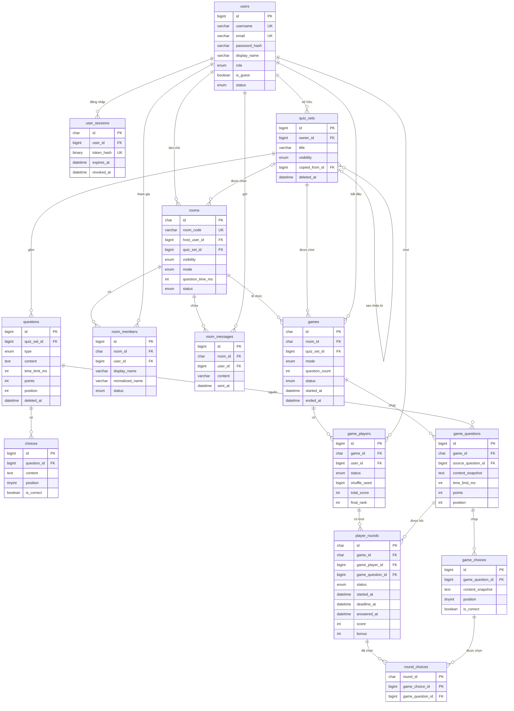

# Database hệ thống Quiz nhiều người dùng

Thiết kế chi tiết và mã MySQL để import cho dự án Quiz nhiều phòng (React, Spring Boot, MySQL, WebSocket). Database gồm **14 bảng** trong bốn nhóm: tài khoản, nội dung, phòng, trận và kết quả. Toàn bộ SQL trong file này đã được import và kiểm thử trên **MySQL 8.0.46**.

## Mục lục

1. [Cách import](#1-cách-import)
2. [Quy ước chung](#2-quy-ước-chung)
3. [ERD](#3-erd)
4. [Từ điển dữ liệu](#4-từ-điển-dữ-liệu)
5. [Quy tắc server phải tự bảo đảm](#5-quy-tắc-server-phải-tự-bảo-đảm)
6. [SQL 1 — Tạo database và bảng](#6-sql-1--tạo-database-và-bảng)
7. [SQL 2 — Dữ liệu mẫu](#7-sql-2--dữ-liệu-mẫu)
8. [SQL 3 — Các luồng giao dịch mẫu](#8-sql-3--các-luồng-giao-dịch-mẫu)
9. [SQL 4 — Đối soát khi server khởi động lại](#9-sql-4--đối-soát-khi-server-khởi-động-lại)
10. [SQL 5 — Truy vấn tra cứu và kiểm toán](#10-sql-5--truy-vấn-tra-cứu-và-kiểm-toán)
11. [Kết quả kiểm thử](#11-kết-quả-kiểm-thử)
12. [Cấu hình kết nối Spring Boot](#12-cấu-hình-kết-nối-spring-boot)

---

## 1. Cách import

Yêu cầu **MySQL 8.0.16 trở lên** (cần CHECK constraint và collation `utf8mb4_0900_*`). MariaDB không dùng được vì khác cú pháp cột sinh và collation.

1. Chép khối SQL ở mục 6 vào file `01_schema.sql`.
2. Chép khối SQL ở mục 7 vào file `02_seed.sql` (tùy chọn, chỉ dùng khi phát triển).
3. Chạy theo đúng thứ tự:

```bash
mysql -u root -p --default-character-set=utf8mb4 < 01_schema.sql
mysql -u root -p --default-character-set=utf8mb4 < 02_seed.sql
```

Hoặc trong MySQL Workbench: mở từng file và chạy toàn bộ (Ctrl+Shift+Enter).

- Chạy lại `01_schema.sql` trên database đã có bảng sẽ báo lỗi "table already exists". Muốn tạo lại từ đầu, bỏ comment dòng `DROP DATABASE` ở đầu file.
- `02_seed.sql` dùng id cố định, chỉ chạy **một lần** ngay sau khi tạo bảng.
- Nếu dùng Flyway, đổi tên thành `V1__schema.sql` và `V2__seed.sql`, đặt trong `src/main/resources/db/migration`, và bỏ hai dòng `CREATE DATABASE` / `USE`.

## 2. Quy ước chung

| Nội dung | Quy ước |
| --- | --- |
| Bảng mã | `utf8mb4`, collation mặc định `utf8mb4_0900_ai_ci` (không phân biệt hoa thường, không phân biệt dấu khi so sánh) |
| Khóa chính | `BIGINT AUTO_INCREMENT`, trừ `user_sessions`, `rooms`, `games`, `player_rounds` dùng UUID `CHAR(36)` vì mã này lộ ra client qua socket |
| Thời gian | `DATETIME(3)` (chính xác mili giây), luôn lưu theo **UTC** |
| Tên cột | `snake_case`; khóa ngoại đặt tên `<bảng>_id` |
| Tên ràng buộc | `pk_`, `uk_` (UNIQUE), `fk_` (khóa ngoại), `ck_` (CHECK), `idx_` (chỉ mục thường) |
| Xóa | Bộ đề và câu hỏi xóa mềm qua `deleted_at`; dữ liệu trận không bao giờ xóa |
| Trạng thái | `ENUM` cho các tập giá trị cố định |
| Cột sinh | Dùng `GENERATED ... STORED` + UNIQUE để biểu diễn "tối đa một dòng đang hoạt động" |

**Vì sao trận cần bản chụp.** Khi bắt đầu trận, server chép câu hỏi và lựa chọn sang `game_questions` và `game_choices`. Người dùng sửa hay xóa bộ đề gốc sau đó không làm thay đổi trận đang chơi hay lịch sử.

**Vì sao nhiều khóa ngoại ghép.** `player_rounds` và `round_choices` mang thêm `game_id` hoặc `game_question_id` để khóa ngoại ghép bảo đảm ngay trong database rằng lượt câu, người chơi và lựa chọn thuộc **cùng một trận, cùng một câu**.

## 3. ERD



GitHub, GitLab, VS Code (có extension Markdown Preview Mermaid) và Notion đều vẽ được khối trên thành sơ đồ.

## 4. Từ điển dữ liệu

Cột `created_at` và `updated_at` (tự cập nhật) có ở các bảng gốc nhưng không liệt kê lại.

### 4.1. Tài khoản

#### `users` — tài khoản thật và tài khoản khách

| Cột | Kiểu | Null | Mặc định | Ý nghĩa |
| --- | --- | --- | --- | --- |
| `id` | BIGINT | | tự tăng | Khóa chính |
| `username` | VARCHAR(50) ascii | Có | | Tên đăng nhập, UNIQUE, không phân biệt hoa thường; NULL với khách |
| `email` | VARCHAR(254) | Có | | UNIQUE; NULL với khách |
| `password_hash` | VARCHAR(255) | Có | | Chuỗi bcrypt; NULL với khách |
| `display_name` | VARCHAR(50) | | | Tên hồ sơ |
| `role` | ENUM USER, ADMIN | | USER | Vai trò toàn cục; chủ phòng **không** phải vai trò |
| `is_guest` | BOOLEAN | | FALSE | Tài khoản khách tạo qua `POST /api/auth/guest` |
| `status` | ENUM ACTIVE, LOCKED | | ACTIVE | Admin khóa thì mọi phiên bị thu hồi |

Ràng buộc: `ck_users_account_kind` buộc tài khoản thật có `username` và `password_hash`, còn khách thì không có `username`, `email`, `password_hash` và luôn là USER.

#### `user_sessions` — phiên đăng nhập

| Cột | Kiểu | Null | Ý nghĩa |
| --- | --- | --- | --- |
| `id` | CHAR(36) | | UUID phiên |
| `user_id` | BIGINT | | FK `users` |
| `token_hash` | BINARY(32) | | SHA-256 của token ngẫu nhiên, UNIQUE; server chỉ trả token thô cho client một lần |
| `created_at`, `expires_at` | DATETIME(3) | | `expires_at` phải sau `created_at` |
| `revoked_at` | DATETIME(3) | Có | Có giá trị khi đăng xuất hoặc bị thu hồi |
| `last_seen_at` | DATETIME(3) | Có | Cập nhật thưa (ví dụ 1 phút/lần) |

Token này dùng cho cả header `Authorization` của REST và thông điệp `AUTH` của socket.

### 4.2. Nội dung

#### `quiz_sets` — bộ đề

| Cột | Kiểu | Null | Mặc định | Ý nghĩa |
| --- | --- | --- | --- | --- |
| `id` | BIGINT | | tự tăng | Khóa chính |
| `owner_id` | BIGINT | | | FK `users`; chỉ chủ sở hữu được sửa, xóa |
| `title` | VARCHAR(200) | | | Không rỗng |
| `description` | TEXT | Có | | |
| `visibility` | ENUM PRIVATE, PUBLIC | | PRIVATE | PUBLIC thì người khác chọn để chơi hoặc sao chép được |
| `copied_from_id` | BIGINT | Có | | FK tự tham chiếu tới bộ đề nguồn; `ON DELETE SET NULL` |
| `deleted_at` | DATETIME(3) | Có | | Xóa mềm |

#### `questions` — câu hỏi gốc

| Cột | Kiểu | Null | Mặc định | Ý nghĩa |
| --- | --- | --- | --- | --- |
| `id` | BIGINT | | tự tăng | Khóa chính |
| `quiz_set_id` | BIGINT | | | FK `quiz_sets` |
| `type` | ENUM SINGLE, MULTIPLE, TRUE_FALSE | | SINGLE | Loại câu |
| `content` | TEXT | | | Không rỗng |
| `image_url` | VARCHAR(500) | Có | | Ảnh minh họa (mở rộng) |
| `time_limit_ms` | INT | Có | | 5 000 đến 300 000; NULL = dùng thời gian của phòng |
| `points` | INT | | 100 | Điểm tối đa P, 10 đến 1 000 |
| `explanation` | TEXT | Có | | Lời giải thích hiện sau khi chốt câu |
| `position` | INT | | | Thứ tự trong bộ đề, lớn hơn 0; không UNIQUE để dễ sắp xếp lại |
| `deleted_at` | DATETIME(3) | Có | | Xóa mềm |

#### `choices` — lựa chọn của câu gốc

| Cột | Kiểu | Null | Mặc định | Ý nghĩa |
| --- | --- | --- | --- | --- |
| `id` | BIGINT | | tự tăng | Khóa chính |
| `question_id` | BIGINT | | | FK `questions`, `ON DELETE CASCADE` |
| `content` | TEXT | | | Không rỗng |
| `position` | TINYINT | | | 1 đến 6; UNIQUE cùng `question_id` |
| `is_correct` | BOOLEAN | | FALSE | |

Không có bảng nào tham chiếu `choices` (trận dùng bản chụp), nên khi sửa câu hỏi server có thể xóa hết lựa chọn cũ rồi chèn lại trong cùng transaction.

### 4.3. Phòng

#### `rooms` — phòng chơi

| Cột | Kiểu | Null | Mặc định | Ý nghĩa |
| --- | --- | --- | --- | --- |
| `id` | CHAR(36) | | | UUID |
| `room_code` | VARCHAR(8) ascii | | | Mã 6 ký tự người dùng nhập, UNIQUE, không phân biệt hoa thường |
| `title` | VARCHAR(100) | | | Tên phòng |
| `host_user_id` | BIGINT | | | FK `users`; chủ phòng hiện tại, đổi được khi chuyển quyền |
| `quiz_set_id` | BIGINT | Có | | FK `quiz_sets`; NULL khi chưa chọn |
| `visibility` | ENUM PUBLIC, PRIVATE | | PUBLIC | PUBLIC hiện ở sảnh |
| `password_hash` | VARCHAR(255) | Có | | bcrypt của mật khẩu phòng |
| `max_players` | SMALLINT | | 20 | 2 đến 100 |
| `mode` | ENUM SELF_PACED, LIVE | | SELF_PACED | Tiến độ riêng hoặc đồng bộ cả phòng |
| `question_time_ms` | INT | | 30 000 | Thời gian mặc định mỗi câu, 5 000 đến 300 000 |
| `shuffle_questions` | BOOLEAN | | TRUE | Chỉ có tác dụng ở SELF_PACED |
| `shuffle_choices` | BOOLEAN | | TRUE | |
| `streak_bonus` | BOOLEAN | | FALSE | Bật thưởng chuỗi |
| `status` | ENUM WAITING, PLAYING, CLOSED | | WAITING | Hết trận thì về WAITING để chơi lại |
| `closed_at` | DATETIME(3) | Có | | Có giá trị khi và chỉ khi CLOSED |

#### `room_members` — thành viên phòng

| Cột | Kiểu | Null | Ý nghĩa |
| --- | --- | --- | --- |
| `id` | BIGINT | | Khóa chính |
| `room_id`, `user_id` | | | FK; UNIQUE cặp này (một dòng cho mỗi người mỗi phòng, vào lại thì UPDATE) |
| `display_name` | VARCHAR(50) | | Tên hiển thị trong phòng |
| `normalized_name` | VARCHAR(50) `utf8mb4_0900_as_cs` | | Tên đã chuẩn hóa: Unicode NFC, trim, gộp khoảng trắng, chữ thường, **giữ dấu** |
| `status` | ENUM JOINED, LEFT, KICKED | | KICKED thì không được vào lại |
| `joined_at` | DATETIME(3) | | Lần vào gần nhất |
| `left_at` | DATETIME(3) | Có | NULL khi và chỉ khi JOINED |
| `active_user_id` | cột sinh | Có | `user_id` nếu JOINED; UNIQUE toàn bảng ⇒ **mỗi tài khoản ở tối đa một phòng** |
| `active_name` | cột sinh | Có | `normalized_name` nếu JOINED; UNIQUE cùng `room_id` ⇒ **không trùng tên trong phòng** |

Collation `as_cs` (phân biệt dấu) khiến "An" và "Ân" là hai tên khác nhau.

#### `room_messages` — chat phòng chờ

| Cột | Kiểu | Null | Ý nghĩa |
| --- | --- | --- | --- |
| `id` | BIGINT | | Khóa chính |
| `room_id`, `user_id` | | | FK |
| `content` | VARCHAR(300) | | Không rỗng |
| `sent_at` | DATETIME(3) | | Chỉ mục `(room_id, sent_at)` để lấy 50 tin gần nhất |

### 4.4. Trận và kết quả

#### `games` — một lần chơi

| Cột | Kiểu | Null | Ý nghĩa |
| --- | --- | --- | --- |
| `id` | CHAR(36) | | UUID, gửi cho client trong `GAME_STARTED` |
| `room_id` | CHAR(36) | | FK `rooms`; một phòng có nhiều trận nối tiếp |
| `quiz_set_id` | BIGINT | | FK bộ đề gốc |
| `quiz_title_snapshot` | VARCHAR(200) | | Tên bộ đề lúc chơi |
| `mode`, `question_time_ms`, `shuffle_questions`, `shuffle_choices`, `streak_bonus` | | | Chép từ phòng lúc bắt đầu; không đọc lại cấu hình phòng khi đang chơi |
| `question_count` | INT | | Số câu đã chụp |
| `status` | ENUM RUNNING, FINISHED, CANCELLED | | |
| `started_by` | BIGINT | | FK `users`: chủ phòng tại thời điểm bắt đầu |
| `started_at`, `ended_at` | DATETIME(3) | `ended_at` có | `ended_at` NULL khi và chỉ khi RUNNING |
| `cancel_reason` | VARCHAR(100) | Có | Bắt buộc khi và chỉ khi CANCELLED |
| `running_room_id` | cột sinh | Có | `room_id` nếu RUNNING; UNIQUE ⇒ **tối đa một trận đang chạy mỗi phòng**, kể cả khi `START_GAME` gửi trùng |

#### `game_questions` — bản chụp câu hỏi

| Cột | Kiểu | Ý nghĩa |
| --- | --- | --- |
| `id` | BIGINT | Khóa chính; `(id, game_id)` UNIQUE để làm đích khóa ngoại ghép |
| `game_id` | CHAR(36) | FK `games` |
| `source_question_id` | BIGINT | FK `questions`; UNIQUE cùng `game_id` (không chụp trùng câu) |
| `type`, `content_snapshot`, `image_url`, `explanation` | | Chép từ câu gốc |
| `time_limit_ms` | INT | Đã chốt, không NULL: lấy của câu nếu có, không thì của phòng |
| `points` | INT | Điểm tối đa P |
| `position` | INT | Thứ tự gốc 1..N, UNIQUE cùng `game_id`; thứ tự xáo của từng người tính từ `shuffle_seed` |

#### `game_choices` — bản chụp lựa chọn

| Cột | Kiểu | Ý nghĩa |
| --- | --- | --- |
| `id` | BIGINT | Khóa chính; **đây là `choiceIds` client gửi trong `SUBMIT_ANSWER`** |
| `game_question_id` | BIGINT | FK; `(id, game_question_id)` UNIQUE để làm đích khóa ngoại ghép |
| `content_snapshot` | TEXT | |
| `position` | TINYINT | 1..6, thứ tự gốc |
| `is_correct` | BOOLEAN | Không bao giờ gửi cho client trước khi câu đóng |

#### `game_players` — người tham gia trận

| Cột | Kiểu | Null | Mặc định | Ý nghĩa |
| --- | --- | --- | --- | --- |
| `id` | BIGINT | | tự tăng | Khóa chính; `(id, game_id)` UNIQUE |
| `game_id`, `user_id` | | | | FK; UNIQUE cặp này |
| `display_name_snapshot` | VARCHAR(50) | | | Tên lúc chốt danh sách |
| `status` | ENUM PLAYING, DISCONNECTED, COMPLETED, LEFT | | PLAYING | |
| `shuffle_seed` | BIGINT | | | Hạt giống xáo thứ tự câu và lựa chọn của riêng người này |
| `total_score` | INT | | 0 | Tổng `score + bonus` các lượt; cập nhật cùng transaction chốt lượt |
| `correct_count` | INT | | 0 | |
| `current_streak`, `best_streak` | INT | | 0 | Chuỗi đúng hiện tại và dài nhất |
| `final_rank` | INT | Có | | Hạng chốt khi trận kết thúc; đồng điểm thì đồng hạng |
| `joined_at` | DATETIME(3) | | | Lúc vào phòng |
| `disconnected_at` | DATETIME(3) | Có | | Có giá trị khi và chỉ khi DISCONNECTED |
| `completed_at` | DATETIME(3) | Có | | Có giá trị khi và chỉ khi COMPLETED |
| `left_at` | DATETIME(3) | Có | | Có giá trị khi và chỉ khi LEFT |

#### `player_rounds` — một lượt câu của một người

| Cột | Kiểu | Null | Mặc định | Ý nghĩa |
| --- | --- | --- | --- | --- |
| `id` | CHAR(36) | | | UUID, chính là `roundId` trên socket |
| `game_id` | CHAR(36) | | | Đi cùng hai khóa ngoại ghép |
| `game_player_id` | BIGINT | | | FK ghép `(game_player_id, game_id)` → `game_players` |
| `game_question_id` | BIGINT | | | FK ghép `(game_question_id, game_id)` → `game_questions` |
| `status` | ENUM ACTIVE, CORRECT, WRONG, TIMEOUT, CANCELLED | | ACTIVE | |
| `started_at`, `deadline_at` | DATETIME(3) | | | Do server quyết định; `deadline_at > started_at` |
| `answered_at` | DATETIME(3) | Có | | Lúc server nhận đáp án; có khi và chỉ khi CORRECT hoặc WRONG, và phải **trước** `deadline_at` |
| `closed_at` | DATETIME(3) | Có | | NULL khi và chỉ khi ACTIVE |
| `score` | INT | | 0 | Điểm theo thời gian; 1..1000 nếu CORRECT, ngược lại 0 |
| `bonus` | INT | | 0 | Thưởng chuỗi 0..50; chỉ khác 0 khi CORRECT |
| `cancel_reason` | VARCHAR(50) | Có | | Bắt buộc khi và chỉ khi CANCELLED (`PLAYER_LEFT`, `SERVER_RESTART`) |
| `active_slot` | cột sinh | Có | | 1 nếu ACTIVE; UNIQUE cùng `game_player_id` ⇒ **mỗi người tối đa một lượt đang mở** |

UNIQUE `(game_player_id, game_question_id)` ⇒ không ai làm lại một câu.

#### `round_choices` — lựa chọn đã gửi trong một lượt

| Cột | Kiểu | Ý nghĩa |
| --- | --- | --- |
| `round_id` | CHAR(36) | Phần của khóa chính |
| `game_choice_id` | BIGINT | Phần của khóa chính |
| `game_question_id` | BIGINT | Có mặt để hai FK ghép bảo đảm lựa chọn thuộc **đúng câu của lượt** |

Câu SINGLE và TRUE_FALSE có 1 dòng, câu MULTIPLE có thể nhiều dòng, lượt TIMEOUT hay CANCELLED không có dòng nào.

### 4.5. Vòng đời trạng thái

| Đối tượng | Chuyển trạng thái |
| --- | --- |
| `rooms.status` | WAITING → PLAYING → WAITING (chơi lại) … → CLOSED khi không còn ai |
| `room_members.status` | JOINED ⇄ LEFT; JOINED → KICKED |
| `games.status` | RUNNING → FINISHED (có ít nhất 1 người COMPLETED) hoặc CANCELLED |
| `game_players.status` | PLAYING ⇄ DISCONNECTED (trong 30 giây) → COMPLETED hoặc LEFT |
| `player_rounds.status` | ACTIVE → CORRECT, WRONG, TIMEOUT hoặc CANCELLED |

## 5. Quy tắc server phải tự bảo đảm

CHECK trong MySQL không đọc được bảng khác, nên các quy tắc sau nằm ở tầng service. Mục 10 có truy vấn kiểm toán để phát hiện sai lệch.

| Quy tắc | Nơi kiểm tra |
| --- | --- |
| Câu SINGLE có đúng 1 đáp án đúng; TRUE_FALSE có đúng 2 lựa chọn và 1 đáp án đúng; MULTIPLE có ít nhất 1 đáp án đúng; mọi câu có 2 đến 6 lựa chọn | API lưu câu hỏi; kiểm toán Q8 |
| Bộ đề được bắt đầu phải chưa xóa, có ít nhất 1 câu, và người bắt đầu là chủ sở hữu hoặc bộ đề PUBLIC | `START_GAME` |
| Số người JOINED không vượt `max_players` | `JOIN_ROOM`, sau `SELECT … FOR UPDATE` trên dòng phòng |
| `host_user_id` là một thành viên JOINED | `CREATE_ROOM`, `TRANSFER_HOST`, `LEAVE_ROOM` |
| Lượt chỉ được chốt một lần | Câu `UPDATE … WHERE status = 'ACTIVE'` trả về đúng 1 dòng (mục 8, F3) |
| CORRECT khi và chỉ khi tập lựa chọn trùng tập đáp án đúng | Service chấm điểm; kiểm toán Q7 |
| `total_score` bằng tổng `score + bonus` các lượt | Cùng transaction chốt lượt; kiểm toán Q5 |
| Ghi database xong, COMMIT xong mới phát thông điệp socket | Mọi luồng |

Công thức điểm (T = `deadline_at − started_at`, R = `deadline_at − answered_at`, đơn vị mili giây, P = `points`):

```text
Đúng và còn hạn:  score = max(1, floor(P × R / T))
Sai hoặc hết giờ: score = 0
Thưởng chuỗi (nếu bật): bonus = min(50, 10 × (chuỗi đúng hiện tại − 1)) với câu đúng thứ 2 trở đi
```

## 6. SQL 1 — Tạo database và bảng

```sql
-- =====================================================================
-- Quiz nhiều người dùng — schema MySQL 8.0.16+
-- 14 bảng: tài khoản (2), nội dung (3), phòng (3), trận và kết quả (6)
-- =====================================================================

SET NAMES utf8mb4;
SET time_zone = '+00:00';

-- Chỉ bỏ comment dòng dưới khi muốn xóa sạch và tạo lại từ đầu:
-- DROP DATABASE IF EXISTS quiz_app;

CREATE DATABASE IF NOT EXISTS quiz_app
  CHARACTER SET utf8mb4
  COLLATE utf8mb4_0900_ai_ci;

USE quiz_app;

-- ---------------------------------------------------------------------
-- 1. TÀI KHOẢN
-- ---------------------------------------------------------------------

CREATE TABLE users (
  id             BIGINT        NOT NULL AUTO_INCREMENT,
  username       VARCHAR(50)   CHARACTER SET ascii COLLATE ascii_general_ci NULL
                 COMMENT 'NULL với tài khoản khách; server giới hạn [a-z0-9_]',
  email          VARCHAR(254)  NULL,
  password_hash  VARCHAR(255)  NULL COMMENT 'bcrypt; NULL với tài khoản khách',
  display_name   VARCHAR(50)   NOT NULL,
  role           ENUM('USER','ADMIN')     NOT NULL DEFAULT 'USER',
  is_guest       BOOLEAN       NOT NULL DEFAULT FALSE,
  status         ENUM('ACTIVE','LOCKED')  NOT NULL DEFAULT 'ACTIVE',
  created_at     DATETIME(3)   NOT NULL DEFAULT CURRENT_TIMESTAMP(3),
  updated_at     DATETIME(3)   NOT NULL DEFAULT CURRENT_TIMESTAMP(3) ON UPDATE CURRENT_TIMESTAMP(3),
  PRIMARY KEY (id),
  UNIQUE KEY uk_users_username (username),
  UNIQUE KEY uk_users_email (email),
  CONSTRAINT ck_users_display_name CHECK (CHAR_LENGTH(TRIM(display_name)) > 0),
  CONSTRAINT ck_users_username_len CHECK (username IS NULL OR CHAR_LENGTH(username) >= 3),
  CONSTRAINT ck_users_account_kind CHECK (
       (is_guest = FALSE AND username IS NOT NULL AND password_hash IS NOT NULL)
    OR (is_guest = TRUE  AND username IS NULL AND email IS NULL
                         AND password_hash IS NULL AND role = 'USER')
  )
) ENGINE=InnoDB COMMENT='Tài khoản thật và tài khoản khách';

CREATE TABLE user_sessions (
  id            CHAR(36)     CHARACTER SET ascii COLLATE ascii_bin NOT NULL,
  user_id       BIGINT       NOT NULL,
  token_hash    BINARY(32)   NOT NULL COMMENT 'SHA-256 của token ngẫu nhiên; không lưu token thô',
  created_at    DATETIME(3)  NOT NULL DEFAULT CURRENT_TIMESTAMP(3),
  expires_at    DATETIME(3)  NOT NULL,
  revoked_at    DATETIME(3)  NULL,
  last_seen_at  DATETIME(3)  NULL,
  PRIMARY KEY (id),
  UNIQUE KEY uk_sessions_token (token_hash),
  KEY idx_sessions_user (user_id, revoked_at),
  CONSTRAINT fk_sessions_user FOREIGN KEY (user_id) REFERENCES users (id),
  CONSTRAINT ck_sessions_expiry CHECK (expires_at > created_at)
) ENGINE=InnoDB COMMENT='Phiên đăng nhập, dùng chung cho REST và socket';

-- ---------------------------------------------------------------------
-- 2. NỘI DUNG
-- ---------------------------------------------------------------------

CREATE TABLE quiz_sets (
  id              BIGINT        NOT NULL AUTO_INCREMENT,
  owner_id        BIGINT        NOT NULL,
  title           VARCHAR(200)  NOT NULL,
  description     TEXT          NULL,
  visibility      ENUM('PRIVATE','PUBLIC') NOT NULL DEFAULT 'PRIVATE',
  copied_from_id  BIGINT        NULL COMMENT 'Bộ đề nguồn khi sao chép',
  deleted_at      DATETIME(3)   NULL COMMENT 'Xóa mềm',
  created_at      DATETIME(3)   NOT NULL DEFAULT CURRENT_TIMESTAMP(3),
  updated_at      DATETIME(3)   NOT NULL DEFAULT CURRENT_TIMESTAMP(3) ON UPDATE CURRENT_TIMESTAMP(3),
  PRIMARY KEY (id),
  KEY idx_quiz_sets_owner (owner_id, deleted_at),
  KEY idx_quiz_sets_public (visibility, deleted_at, updated_at),
  KEY idx_quiz_sets_copied (copied_from_id),
  CONSTRAINT fk_quiz_sets_owner  FOREIGN KEY (owner_id)       REFERENCES users (id),
  CONSTRAINT fk_quiz_sets_copied FOREIGN KEY (copied_from_id) REFERENCES quiz_sets (id) ON DELETE SET NULL,
  CONSTRAINT ck_quiz_sets_title CHECK (CHAR_LENGTH(TRIM(title)) > 0)
) ENGINE=InnoDB COMMENT='Bộ đề, thuộc sở hữu của một người dùng';

CREATE TABLE questions (
  id             BIGINT       NOT NULL AUTO_INCREMENT,
  quiz_set_id    BIGINT       NOT NULL,
  type           ENUM('SINGLE','MULTIPLE','TRUE_FALSE') NOT NULL DEFAULT 'SINGLE',
  content        TEXT         NOT NULL,
  image_url      VARCHAR(500) NULL,
  time_limit_ms  INT          NULL COMMENT 'NULL = dùng thời gian của phòng',
  points         INT          NOT NULL DEFAULT 100 COMMENT 'Điểm tối đa P',
  explanation    TEXT         NULL COMMENT 'Lời giải thích hiện sau khi chốt câu',
  position       INT          NOT NULL,
  deleted_at     DATETIME(3)  NULL,
  created_at     DATETIME(3)  NOT NULL DEFAULT CURRENT_TIMESTAMP(3),
  updated_at     DATETIME(3)  NOT NULL DEFAULT CURRENT_TIMESTAMP(3) ON UPDATE CURRENT_TIMESTAMP(3),
  PRIMARY KEY (id),
  KEY idx_questions_set (quiz_set_id, deleted_at, position),
  CONSTRAINT fk_questions_set FOREIGN KEY (quiz_set_id) REFERENCES quiz_sets (id),
  CONSTRAINT ck_questions_content  CHECK (CHAR_LENGTH(TRIM(content)) > 0),
  CONSTRAINT ck_questions_time     CHECK (time_limit_ms IS NULL OR time_limit_ms BETWEEN 5000 AND 300000),
  CONSTRAINT ck_questions_points   CHECK (points BETWEEN 10 AND 1000),
  CONSTRAINT ck_questions_position CHECK (position > 0)
) ENGINE=InnoDB COMMENT='Câu hỏi gốc, xóa mềm';

CREATE TABLE choices (
  id           BIGINT    NOT NULL AUTO_INCREMENT,
  question_id  BIGINT    NOT NULL,
  content      TEXT      NOT NULL,
  position     TINYINT   NOT NULL COMMENT '1..6',
  is_correct   BOOLEAN   NOT NULL DEFAULT FALSE,
  PRIMARY KEY (id),
  UNIQUE KEY uk_choices_position (question_id, position),
  CONSTRAINT fk_choices_question FOREIGN KEY (question_id) REFERENCES questions (id) ON DELETE CASCADE,
  CONSTRAINT ck_choices_content  CHECK (CHAR_LENGTH(TRIM(content)) > 0),
  CONSTRAINT ck_choices_position CHECK (position BETWEEN 1 AND 6)
) ENGINE=InnoDB COMMENT='Lựa chọn của câu gốc; số đáp án đúng do server kiểm tra theo loại câu';

-- ---------------------------------------------------------------------
-- 3. PHÒNG
-- ---------------------------------------------------------------------

CREATE TABLE rooms (
  id                 CHAR(36)     CHARACTER SET ascii COLLATE ascii_bin NOT NULL,
  room_code          VARCHAR(8)   CHARACTER SET ascii COLLATE ascii_general_ci NOT NULL,
  title              VARCHAR(100) NOT NULL,
  host_user_id       BIGINT       NOT NULL COMMENT 'Chủ phòng hiện tại',
  quiz_set_id        BIGINT       NULL COMMENT 'NULL khi chưa chọn bộ đề',
  visibility         ENUM('PUBLIC','PRIVATE') NOT NULL DEFAULT 'PUBLIC',
  password_hash      VARCHAR(255) NULL COMMENT 'bcrypt; NULL = không đặt mật khẩu',
  max_players        SMALLINT     NOT NULL DEFAULT 20,
  mode               ENUM('SELF_PACED','LIVE') NOT NULL DEFAULT 'SELF_PACED',
  question_time_ms   INT          NOT NULL DEFAULT 30000,
  shuffle_questions  BOOLEAN      NOT NULL DEFAULT TRUE,
  shuffle_choices    BOOLEAN      NOT NULL DEFAULT TRUE,
  streak_bonus       BOOLEAN      NOT NULL DEFAULT FALSE,
  status             ENUM('WAITING','PLAYING','CLOSED') NOT NULL DEFAULT 'WAITING',
  created_at         DATETIME(3)  NOT NULL DEFAULT CURRENT_TIMESTAMP(3),
  updated_at         DATETIME(3)  NOT NULL DEFAULT CURRENT_TIMESTAMP(3) ON UPDATE CURRENT_TIMESTAMP(3),
  closed_at          DATETIME(3)  NULL,
  PRIMARY KEY (id),
  UNIQUE KEY uk_rooms_code (room_code),
  KEY idx_rooms_lobby (visibility, status, created_at),
  KEY idx_rooms_host (host_user_id),
  KEY idx_rooms_quiz_set (quiz_set_id),
  CONSTRAINT fk_rooms_host     FOREIGN KEY (host_user_id) REFERENCES users (id),
  CONSTRAINT fk_rooms_quiz_set FOREIGN KEY (quiz_set_id)  REFERENCES quiz_sets (id),
  CONSTRAINT ck_rooms_code     CHECK (CHAR_LENGTH(room_code) = 6),
  CONSTRAINT ck_rooms_title    CHECK (CHAR_LENGTH(TRIM(title)) > 0),
  CONSTRAINT ck_rooms_players  CHECK (max_players BETWEEN 2 AND 100),
  CONSTRAINT ck_rooms_time     CHECK (question_time_ms BETWEEN 5000 AND 300000),
  CONSTRAINT ck_rooms_closed   CHECK ((status = 'CLOSED') = (closed_at IS NOT NULL))
) ENGINE=InnoDB COMMENT='Phòng chơi; một phòng có thể tổ chức nhiều trận nối tiếp';

CREATE TABLE room_members (
  id               BIGINT       NOT NULL AUTO_INCREMENT,
  room_id          CHAR(36)     CHARACTER SET ascii COLLATE ascii_bin NOT NULL,
  user_id          BIGINT       NOT NULL,
  display_name     VARCHAR(50)  NOT NULL,
  normalized_name  VARCHAR(50)  COLLATE utf8mb4_0900_as_cs NOT NULL
                   COMMENT 'NFC, trim, gộp khoảng trắng, chữ thường; giữ dấu',
  status           ENUM('JOINED','LEFT','KICKED') NOT NULL DEFAULT 'JOINED',
  joined_at        DATETIME(3)  NOT NULL DEFAULT CURRENT_TIMESTAMP(3) COMMENT 'Lần vào gần nhất',
  left_at          DATETIME(3)  NULL,
  active_user_id   BIGINT GENERATED ALWAYS AS (IF(status = 'JOINED', user_id, NULL)) STORED,
  active_name      VARCHAR(50) COLLATE utf8mb4_0900_as_cs
                   GENERATED ALWAYS AS (IF(status = 'JOINED', normalized_name, NULL)) STORED,
  PRIMARY KEY (id),
  UNIQUE KEY uk_members_room_user  (room_id, user_id),
  UNIQUE KEY uk_members_one_room   (active_user_id),
  UNIQUE KEY uk_members_name       (room_id, active_name),
  KEY idx_members_user (user_id),
  CONSTRAINT fk_members_room FOREIGN KEY (room_id) REFERENCES rooms (id),
  CONSTRAINT fk_members_user FOREIGN KEY (user_id) REFERENCES users (id),
  CONSTRAINT ck_members_name CHECK (CHAR_LENGTH(TRIM(display_name)) > 0),
  CONSTRAINT ck_members_left CHECK ((status = 'JOINED') = (left_at IS NULL))
) ENGINE=InnoDB COMMENT='Thành viên phòng; mỗi tài khoản ở tối đa một phòng tại một thời điểm';

CREATE TABLE room_messages (
  id        BIGINT        NOT NULL AUTO_INCREMENT,
  room_id   CHAR(36)      CHARACTER SET ascii COLLATE ascii_bin NOT NULL,
  user_id   BIGINT        NOT NULL,
  content   VARCHAR(300)  NOT NULL,
  sent_at   DATETIME(3)   NOT NULL DEFAULT CURRENT_TIMESTAMP(3),
  PRIMARY KEY (id),
  KEY idx_messages_room (room_id, sent_at),
  KEY idx_messages_user (user_id),
  CONSTRAINT fk_messages_room FOREIGN KEY (room_id) REFERENCES rooms (id),
  CONSTRAINT fk_messages_user FOREIGN KEY (user_id) REFERENCES users (id),
  CONSTRAINT ck_messages_content CHECK (CHAR_LENGTH(TRIM(content)) > 0)
) ENGINE=InnoDB COMMENT='Chat trong phòng chờ';

-- ---------------------------------------------------------------------
-- 4. TRẬN VÀ KẾT QUẢ
-- ---------------------------------------------------------------------

CREATE TABLE games (
  id                   CHAR(36)     CHARACTER SET ascii COLLATE ascii_bin NOT NULL,
  room_id              CHAR(36)     CHARACTER SET ascii COLLATE ascii_bin NOT NULL,
  quiz_set_id          BIGINT       NOT NULL,
  quiz_title_snapshot  VARCHAR(200) NOT NULL,
  mode                 ENUM('SELF_PACED','LIVE') NOT NULL,
  question_time_ms     INT          NOT NULL COMMENT 'Thời gian mặc định của phòng lúc bắt đầu',
  shuffle_questions    BOOLEAN      NOT NULL,
  shuffle_choices      BOOLEAN      NOT NULL,
  streak_bonus         BOOLEAN      NOT NULL,
  question_count       INT          NOT NULL,
  status               ENUM('RUNNING','FINISHED','CANCELLED') NOT NULL DEFAULT 'RUNNING',
  started_by           BIGINT       NOT NULL,
  started_at           DATETIME(3)  NOT NULL,
  ended_at             DATETIME(3)  NULL,
  cancel_reason        VARCHAR(100) NULL,
  running_room_id      CHAR(36) CHARACTER SET ascii COLLATE ascii_bin
                       GENERATED ALWAYS AS (IF(status = 'RUNNING', room_id, NULL)) STORED,
  PRIMARY KEY (id),
  UNIQUE KEY uk_games_one_running (running_room_id),
  KEY idx_games_room (room_id, started_at),
  KEY idx_games_quiz_set (quiz_set_id),
  KEY idx_games_started_by (started_by),
  CONSTRAINT fk_games_room       FOREIGN KEY (room_id)     REFERENCES rooms (id),
  CONSTRAINT fk_games_quiz_set   FOREIGN KEY (quiz_set_id) REFERENCES quiz_sets (id),
  CONSTRAINT fk_games_started_by FOREIGN KEY (started_by)  REFERENCES users (id),
  CONSTRAINT ck_games_count   CHECK (question_count > 0),
  CONSTRAINT ck_games_time    CHECK (question_time_ms BETWEEN 5000 AND 300000),
  CONSTRAINT ck_games_ended   CHECK ((status = 'RUNNING') = (ended_at IS NULL)),
  CONSTRAINT ck_games_order   CHECK (ended_at IS NULL OR ended_at >= started_at),
  CONSTRAINT ck_games_cancel  CHECK ((status = 'CANCELLED') = (cancel_reason IS NOT NULL))
) ENGINE=InnoDB COMMENT='Một lần chơi; cấu hình được chép từ phòng lúc bắt đầu';

CREATE TABLE game_questions (
  id                  BIGINT        NOT NULL AUTO_INCREMENT,
  game_id             CHAR(36)      CHARACTER SET ascii COLLATE ascii_bin NOT NULL,
  source_question_id  BIGINT        NOT NULL,
  type                ENUM('SINGLE','MULTIPLE','TRUE_FALSE') NOT NULL,
  content_snapshot    TEXT          NOT NULL,
  image_url           VARCHAR(500)  NULL,
  time_limit_ms       INT           NOT NULL COMMENT 'Đã chốt: thời gian riêng của câu hoặc của phòng',
  points              INT           NOT NULL,
  explanation         TEXT          NULL,
  position            INT           NOT NULL COMMENT 'Thứ tự gốc 1..N',
  PRIMARY KEY (id),
  UNIQUE KEY uk_gq_position (game_id, position),
  UNIQUE KEY uk_gq_source   (game_id, source_question_id),
  UNIQUE KEY uk_gq_id_game  (id, game_id),
  KEY idx_gq_source (source_question_id),
  CONSTRAINT fk_gq_game   FOREIGN KEY (game_id)            REFERENCES games (id),
  CONSTRAINT fk_gq_source FOREIGN KEY (source_question_id) REFERENCES questions (id),
  CONSTRAINT ck_gq_time     CHECK (time_limit_ms BETWEEN 5000 AND 300000),
  CONSTRAINT ck_gq_points   CHECK (points BETWEEN 10 AND 1000),
  CONSTRAINT ck_gq_position CHECK (position > 0)
) ENGINE=InnoDB COMMENT='Bản chụp câu hỏi lúc bắt đầu trận';

CREATE TABLE game_choices (
  id                BIGINT   NOT NULL AUTO_INCREMENT,
  game_question_id  BIGINT   NOT NULL,
  content_snapshot  TEXT     NOT NULL,
  position          TINYINT  NOT NULL,
  is_correct        BOOLEAN  NOT NULL,
  PRIMARY KEY (id),
  UNIQUE KEY uk_gc_position (game_question_id, position),
  UNIQUE KEY uk_gc_id_q     (id, game_question_id),
  CONSTRAINT fk_gc_question FOREIGN KEY (game_question_id) REFERENCES game_questions (id),
  CONSTRAINT ck_gc_position CHECK (position BETWEEN 1 AND 6)
) ENGINE=InnoDB COMMENT='Bản chụp lựa chọn; choiceIds trong SUBMIT_ANSWER là id của bảng này';

CREATE TABLE game_players (
  id                     BIGINT       NOT NULL AUTO_INCREMENT,
  game_id                CHAR(36)     CHARACTER SET ascii COLLATE ascii_bin NOT NULL,
  user_id                BIGINT       NOT NULL,
  display_name_snapshot  VARCHAR(50)  NOT NULL,
  status                 ENUM('PLAYING','DISCONNECTED','COMPLETED','LEFT') NOT NULL DEFAULT 'PLAYING',
  shuffle_seed           BIGINT       NOT NULL COMMENT 'Sinh thứ tự câu và lựa chọn riêng',
  total_score            INT          NOT NULL DEFAULT 0,
  correct_count          INT          NOT NULL DEFAULT 0,
  current_streak         INT          NOT NULL DEFAULT 0,
  best_streak            INT          NOT NULL DEFAULT 0,
  final_rank             INT          NULL COMMENT 'NULL khi trận chưa kết thúc',
  joined_at              DATETIME(3)  NOT NULL,
  disconnected_at        DATETIME(3)  NULL COMMENT 'Có giá trị khi đang chờ kết nối lại',
  completed_at           DATETIME(3)  NULL,
  left_at                DATETIME(3)  NULL,
  PRIMARY KEY (id),
  UNIQUE KEY uk_gp_game_user (game_id, user_id),
  UNIQUE KEY uk_gp_id_game   (id, game_id),
  KEY idx_gp_user (user_id, game_id),
  CONSTRAINT fk_gp_game FOREIGN KEY (game_id) REFERENCES games (id),
  CONSTRAINT fk_gp_user FOREIGN KEY (user_id) REFERENCES users (id),
  CONSTRAINT ck_gp_counters   CHECK (total_score >= 0 AND correct_count >= 0
                                     AND current_streak >= 0 AND best_streak >= current_streak),
  CONSTRAINT ck_gp_rank       CHECK (final_rank IS NULL OR final_rank >= 1),
  CONSTRAINT ck_gp_disconnect CHECK ((status = 'DISCONNECTED') = (disconnected_at IS NOT NULL)),
  CONSTRAINT ck_gp_completed  CHECK ((status = 'COMPLETED') = (completed_at IS NOT NULL)),
  CONSTRAINT ck_gp_left       CHECK ((status = 'LEFT') = (left_at IS NOT NULL))
) ENGINE=InnoDB COMMENT='Người tham gia một trận';

CREATE TABLE player_rounds (
  id                CHAR(36)     CHARACTER SET ascii COLLATE ascii_bin NOT NULL COMMENT '= roundId',
  game_id           CHAR(36)     CHARACTER SET ascii COLLATE ascii_bin NOT NULL,
  game_player_id    BIGINT       NOT NULL,
  game_question_id  BIGINT       NOT NULL,
  status            ENUM('ACTIVE','CORRECT','WRONG','TIMEOUT','CANCELLED') NOT NULL DEFAULT 'ACTIVE',
  started_at        DATETIME(3)  NOT NULL,
  deadline_at       DATETIME(3)  NOT NULL,
  answered_at       DATETIME(3)  NULL COMMENT 'Lúc server nhận đáp án',
  closed_at         DATETIME(3)  NULL COMMENT 'Lúc lượt được chốt hoặc hủy',
  score             INT          NOT NULL DEFAULT 0 COMMENT 'Điểm theo thời gian',
  bonus             INT          NOT NULL DEFAULT 0 COMMENT 'Thưởng chuỗi',
  cancel_reason     VARCHAR(50)  NULL,
  active_slot       TINYINT GENERATED ALWAYS AS (IF(status = 'ACTIVE', 1, NULL)) STORED,
  PRIMARY KEY (id),
  UNIQUE KEY uk_pr_once      (game_player_id, game_question_id),
  UNIQUE KEY uk_pr_one_active (game_player_id, active_slot),
  UNIQUE KEY uk_pr_id_q      (id, game_question_id),
  KEY idx_pr_player_game   (game_player_id, game_id),
  KEY idx_pr_question_game (game_question_id, game_id),
  KEY idx_pr_open (game_id, status, deadline_at),
  CONSTRAINT fk_pr_player   FOREIGN KEY (game_player_id, game_id)
                            REFERENCES game_players (id, game_id),
  CONSTRAINT fk_pr_question FOREIGN KEY (game_question_id, game_id)
                            REFERENCES game_questions (id, game_id),
  CONSTRAINT ck_pr_deadline CHECK (deadline_at > started_at),
  CONSTRAINT ck_pr_closed   CHECK ((status = 'ACTIVE') = (closed_at IS NULL)),
  CONSTRAINT ck_pr_answered CHECK ((status IN ('CORRECT','WRONG')) = (answered_at IS NOT NULL)),
  CONSTRAINT ck_pr_in_time  CHECK (answered_at IS NULL
                                   OR (answered_at >= started_at AND answered_at < deadline_at)),
  CONSTRAINT ck_pr_score    CHECK ((status = 'CORRECT' AND score BETWEEN 1 AND 1000 AND bonus BETWEEN 0 AND 50)
                                   OR (status <> 'CORRECT' AND score = 0 AND bonus = 0)),
  CONSTRAINT ck_pr_cancel   CHECK ((status = 'CANCELLED') = (cancel_reason IS NOT NULL))
) ENGINE=InnoDB COMMENT='Một lượt câu của một người: thời hạn riêng và kết quả';

CREATE TABLE round_choices (
  round_id          CHAR(36)  CHARACTER SET ascii COLLATE ascii_bin NOT NULL,
  game_question_id  BIGINT    NOT NULL COMMENT 'Bảo đảm lựa chọn thuộc đúng câu của lượt',
  game_choice_id    BIGINT    NOT NULL,
  PRIMARY KEY (round_id, game_choice_id),
  KEY idx_rc_round  (round_id, game_question_id),
  KEY idx_rc_choice (game_choice_id, game_question_id),
  CONSTRAINT fk_rc_round  FOREIGN KEY (round_id, game_question_id)
                          REFERENCES player_rounds (id, game_question_id),
  CONSTRAINT fk_rc_choice FOREIGN KEY (game_choice_id, game_question_id)
                          REFERENCES game_choices (id, game_question_id)
) ENGINE=InnoDB COMMENT='Các lựa chọn người chơi đã gửi trong một lượt';
```

## 7. SQL 2 — Dữ liệu mẫu

Kịch bản: Vĩ tạo bộ đề công khai "Lập trình mạng cơ bản" (3 câu, đủ ba loại). Ở phòng `QUIZ01`, Vĩ và An chơi một trận tiến độ riêng đã kết thúc: Vĩ 149 điểm hạng 1, An 130 điểm hạng 2. Phòng `QUIZ02` của Huy đang chờ ở chế độ LIVE, có một khách đã vào.

| Tài khoản | Mật khẩu | Vai trò |
| --- | --- | --- |
| `admin_demo` | `QuizDemo@123` | ADMIN |
| `vi_demo`, `an_demo`, `huy_demo` | `QuizDemo@123` | USER |
| Khách 01 (id 5) | không có | USER, khách |

Hash có tiền tố `$2b$`; `BCryptPasswordEncoder` của Spring Security 5.5 trở lên đọc được trực tiếp. Đây là tài khoản thử nghiệm, phải xóa trước khi triển khai thật.

```sql
-- =====================================================================
-- Dữ liệu mẫu để phát triển. Chỉ chạy MỘT LẦN trên database vừa tạo.
-- Mật khẩu mọi tài khoản thật: QuizDemo@123 (bcrypt cost 12)
-- =====================================================================

USE quiz_app;
SET NAMES utf8mb4;
SET time_zone = '+00:00';

START TRANSACTION;

-- Tài khoản ------------------------------------------------------------
INSERT INTO users (id, username, email, password_hash, display_name, role, is_guest, status, created_at) VALUES
 (1, 'admin_demo', 'admin@quiz.local', '$2b$12$0iY5TmWs6RTgqV27pRv1DOpxWZBGMI.OHflqqwnnxOu93Km7vHAY.', 'Quản trị', 'ADMIN', FALSE, 'ACTIVE', '2026-11-01 08:00:00.000'),
 (2, 'vi_demo',    'vi@quiz.local',    '$2b$12$0iY5TmWs6RTgqV27pRv1DOpxWZBGMI.OHflqqwnnxOu93Km7vHAY.', 'Vĩ',       'USER',  FALSE, 'ACTIVE', '2026-11-01 08:05:00.000'),
 (3, 'an_demo',    'an@quiz.local',    '$2b$12$0iY5TmWs6RTgqV27pRv1DOpxWZBGMI.OHflqqwnnxOu93Km7vHAY.', 'An',       'USER',  FALSE, 'ACTIVE', '2026-11-01 08:10:00.000'),
 (4, 'huy_demo',   'huy@quiz.local',   '$2b$12$0iY5TmWs6RTgqV27pRv1DOpxWZBGMI.OHflqqwnnxOu93Km7vHAY.', 'Huy',      'USER',  FALSE, 'ACTIVE', '2026-11-01 08:15:00.000'),
 (5, NULL,         NULL,               NULL,                                                           'Khách 01', 'USER',  TRUE,  'ACTIVE', '2026-11-12 09:00:00.000');

-- Bộ đề ----------------------------------------------------------------
INSERT INTO quiz_sets (id, owner_id, title, description, visibility, created_at) VALUES
 (1, 2, 'Lập trình mạng cơ bản', 'TCP, WebSocket và HTTP', 'PUBLIC', '2026-11-02 10:00:00.000');

INSERT INTO questions (id, quiz_set_id, type, content, time_limit_ms, points, explanation, position) VALUES
 (1, 1, 'SINGLE',
  'Giao thức nào ở tầng giao vận bảo đảm truyền tin cậy và đúng thứ tự?',
  NULL, 100, 'TCP dùng số thứ tự, báo nhận và truyền lại.', 1),
 (2, 1, 'MULTIPLE',
  'Những phát biểu nào đúng về WebSocket?',
  NULL, 100, 'WebSocket bắt tay bằng HTTP Upgrade rồi giữ một kết nối TCP hai chiều.', 2),
 (3, 1, 'TRUE_FALSE',
  'HTTP là giao thức không trạng thái (stateless).',
  20000, 100, 'Mỗi yêu cầu HTTP độc lập; trạng thái được giữ bằng cookie hoặc token.', 3);

INSERT INTO choices (id, question_id, content, position, is_correct) VALUES
 (1, 1, 'TCP',  1, TRUE),
 (2, 1, 'UDP',  2, FALSE),
 (3, 1, 'IP',   3, FALSE),
 (4, 1, 'ICMP', 4, FALSE),
 (5, 2, 'Bắt tay ban đầu bằng yêu cầu HTTP Upgrade', 1, TRUE),
 (6, 2, 'Server có thể chủ động gửi dữ liệu cho client', 2, TRUE),
 (7, 2, 'Chạy trên UDP', 3, FALSE),
 (8, 2, 'Mỗi tin nhắn phải mở một kết nối mới', 4, FALSE),
 (9, 3, 'Đúng', 1, TRUE),
 (10, 3, 'Sai', 2, FALSE);

-- Phòng QUIZ01: đã chơi một trận, hiện đã đóng --------------------------
INSERT INTO rooms (id, room_code, title, host_user_id, quiz_set_id, visibility, max_players, mode,
                   question_time_ms, shuffle_questions, shuffle_choices, streak_bonus,
                   status, created_at, closed_at) VALUES
 ('7b1e0c52-1a2b-4c3d-8e4f-000000000001', 'QUIZ01', 'Ôn tập giữa kỳ', 2, 1, 'PUBLIC', 20, 'SELF_PACED',
  30000, FALSE, FALSE, FALSE, 'CLOSED', '2026-11-10 12:55:00.000', '2026-11-10 13:05:00.000');

INSERT INTO room_members (room_id, user_id, display_name, normalized_name, status, joined_at, left_at) VALUES
 ('7b1e0c52-1a2b-4c3d-8e4f-000000000001', 2, 'Vĩ', 'vĩ', 'LEFT', '2026-11-10 12:55:00.000', '2026-11-10 13:05:00.000'),
 ('7b1e0c52-1a2b-4c3d-8e4f-000000000001', 3, 'An', 'an', 'LEFT', '2026-11-10 12:57:00.000', '2026-11-10 13:05:00.000');

INSERT INTO room_messages (room_id, user_id, content, sent_at) VALUES
 ('7b1e0c52-1a2b-4c3d-8e4f-000000000001', 3, 'Sẵn sàng rồi!', '2026-11-10 12:58:00.000'),
 ('7b1e0c52-1a2b-4c3d-8e4f-000000000001', 2, 'Bắt đầu nhé', '2026-11-10 12:59:30.000');

INSERT INTO games (id, room_id, quiz_set_id, quiz_title_snapshot, mode, question_time_ms,
                   shuffle_questions, shuffle_choices, streak_bonus, question_count,
                   status, started_by, started_at, ended_at) VALUES
 ('3f9a6d10-5b2c-4e7f-9a10-000000000001', '7b1e0c52-1a2b-4c3d-8e4f-000000000001', 1,
  'Lập trình mạng cơ bản', 'SELF_PACED', 30000, FALSE, FALSE, FALSE, 3,
  'FINISHED', 2, '2026-11-10 13:00:00.000', '2026-11-10 13:00:35.000');

INSERT INTO game_questions (id, game_id, source_question_id, type, content_snapshot,
                            time_limit_ms, points, explanation, position)
SELECT q.id, '3f9a6d10-5b2c-4e7f-9a10-000000000001', q.id, q.type, q.content,
       COALESCE(q.time_limit_ms, 30000), q.points, q.explanation, q.position
FROM questions q WHERE q.quiz_set_id = 1 AND q.deleted_at IS NULL;

INSERT INTO game_choices (id, game_question_id, content_snapshot, position, is_correct)
SELECT c.id, c.question_id, c.content, c.position, c.is_correct
FROM choices c JOIN questions q ON q.id = c.question_id WHERE q.quiz_set_id = 1;

INSERT INTO game_players (id, game_id, user_id, display_name_snapshot, status, shuffle_seed,
                          total_score, correct_count, current_streak, best_streak, final_rank,
                          joined_at, completed_at) VALUES
 (1, '3f9a6d10-5b2c-4e7f-9a10-000000000001', 2, 'Vĩ', 'COMPLETED', 918273645, 149, 2, 0, 2, 1,
  '2026-11-10 12:55:00.000', '2026-11-10 13:00:35.000'),
 (2, '3f9a6d10-5b2c-4e7f-9a10-000000000001', 3, 'An', 'COMPLETED', 564738291, 130, 2, 1, 1, 2,
  '2026-11-10 12:57:00.000', '2026-11-10 13:00:24.000');

-- Vĩ: câu 1 đúng sau 5 s (83), câu 2 đúng sau 10 s (66), câu 3 hết giờ (0) → 149
-- An: câu 1 đúng sau 15 s (50), câu 2 sai (0), câu 3 đúng sau 4 s trên 20 s (80) → 130
INSERT INTO player_rounds (id, game_id, game_player_id, game_question_id, status,
                           started_at, deadline_at, answered_at, closed_at, score) VALUES
 ('a0000000-0000-4000-8000-000000000101', '3f9a6d10-5b2c-4e7f-9a10-000000000001', 1, 1, 'CORRECT',
  '2026-11-10 13:00:00.000', '2026-11-10 13:00:30.000', '2026-11-10 13:00:05.000', '2026-11-10 13:00:05.000', 83),
 ('a0000000-0000-4000-8000-000000000102', '3f9a6d10-5b2c-4e7f-9a10-000000000001', 1, 2, 'CORRECT',
  '2026-11-10 13:00:05.000', '2026-11-10 13:00:35.000', '2026-11-10 13:00:15.000', '2026-11-10 13:00:15.000', 66),
 ('a0000000-0000-4000-8000-000000000103', '3f9a6d10-5b2c-4e7f-9a10-000000000001', 1, 3, 'TIMEOUT',
  '2026-11-10 13:00:15.000', '2026-11-10 13:00:35.000', NULL,                      '2026-11-10 13:00:35.000', 0),
 ('a0000000-0000-4000-8000-000000000201', '3f9a6d10-5b2c-4e7f-9a10-000000000001', 2, 1, 'CORRECT',
  '2026-11-10 13:00:00.000', '2026-11-10 13:00:30.000', '2026-11-10 13:00:15.000', '2026-11-10 13:00:15.000', 50),
 ('a0000000-0000-4000-8000-000000000202', '3f9a6d10-5b2c-4e7f-9a10-000000000001', 2, 2, 'WRONG',
  '2026-11-10 13:00:15.000', '2026-11-10 13:00:45.000', '2026-11-10 13:00:20.000', '2026-11-10 13:00:20.000', 0),
 ('a0000000-0000-4000-8000-000000000203', '3f9a6d10-5b2c-4e7f-9a10-000000000001', 2, 3, 'CORRECT',
  '2026-11-10 13:00:20.000', '2026-11-10 13:00:40.000', '2026-11-10 13:00:24.000', '2026-11-10 13:00:24.000', 80);

INSERT INTO round_choices (round_id, game_question_id, game_choice_id) VALUES
 ('a0000000-0000-4000-8000-000000000101', 1, 1),
 ('a0000000-0000-4000-8000-000000000102', 2, 5),
 ('a0000000-0000-4000-8000-000000000102', 2, 6),
 ('a0000000-0000-4000-8000-000000000201', 1, 1),
 ('a0000000-0000-4000-8000-000000000202', 2, 5),
 ('a0000000-0000-4000-8000-000000000202', 2, 7),
 ('a0000000-0000-4000-8000-000000000203', 3, 9);

-- Phòng QUIZ02: đang chờ, Huy là chủ phòng, khách đã vào ---------------
INSERT INTO rooms (id, room_code, title, host_user_id, quiz_set_id, visibility, max_players, mode,
                   question_time_ms, status, created_at) VALUES
 ('7b1e0c52-1a2b-4c3d-8e4f-000000000002', 'QUIZ02', 'Luyện tập buổi tối', 4, 1, 'PUBLIC', 10, 'LIVE',
  20000, 'WAITING', '2026-11-12 09:00:00.000');

INSERT INTO room_members (room_id, user_id, display_name, normalized_name, status, joined_at) VALUES
 ('7b1e0c52-1a2b-4c3d-8e4f-000000000002', 4, 'Huy',      'huy',      'JOINED', '2026-11-12 09:00:00.000'),
 ('7b1e0c52-1a2b-4c3d-8e4f-000000000002', 5, 'Khách 01', 'khách 01', 'JOINED', '2026-11-12 09:01:00.000');

COMMIT;

-- Đưa bộ đếm AUTO_INCREMENT qua các id đã chèn tay (MySQL tự làm, đây chỉ để chắc chắn)
ALTER TABLE users          AUTO_INCREMENT = 100;
ALTER TABLE quiz_sets      AUTO_INCREMENT = 100;
ALTER TABLE questions      AUTO_INCREMENT = 100;
ALTER TABLE choices        AUTO_INCREMENT = 100;
ALTER TABLE game_questions AUTO_INCREMENT = 100;
ALTER TABLE game_choices   AUTO_INCREMENT = 100;
ALTER TABLE game_players   AUTO_INCREMENT = 100;
```

## 8. SQL 3 — Các luồng giao dịch mẫu

Đây là SQL tham khảo cho tầng repository, viết bằng biến `@...` để chạy thử ngay trên dữ liệu mẫu. Trong Java, thay biến bằng tham số `?` của `PreparedStatement` và lấy số dòng bị đổi từ giá trị trả về của `executeUpdate()`.

- **F1 START_GAME:** khóa phòng, khóa chia sẻ bộ đề, tạo trận, chụp câu hỏi và lựa chọn, chốt danh sách người chơi, chuyển phòng sang PLAYING.
- **F2 Mở lượt:** chế độ LIVE mở cùng một câu cho mọi người; chế độ SELF_PACED mở cho từng người khi họ chốt câu trước.
- **F3 SUBMIT_ANSWER:** chốt lượt bằng `UPDATE` có điều kiện; chỉ khi được 1 dòng mới ghi lựa chọn và cộng điểm. Gửi trùng trả 0 dòng nên không cộng lần hai.
- **F4 Hết giờ:** chốt TIMEOUT các lượt quá hạn và đứt chuỗi.
- **F5 Kết thúc:** chốt trạng thái, xếp hạng bằng `RANK()`, đưa phòng về WAITING.

```sql
USE quiz_app;
SET NAMES utf8mb4;
SET time_zone = '+00:00';

-- ===== F1. START_GAME (phòng QUIZ02, chủ phòng Huy = 4) =====
SET @room := '7b1e0c52-1a2b-4c3d-8e4f-000000000002';
SET @game := 'c1d2e3f4-0000-4000-8000-000000000002';
SET @now  := '2026-11-12 09:10:00.000';

START TRANSACTION;
SELECT id FROM rooms WHERE id = @room AND status = 'WAITING' AND host_user_id = 4 FOR UPDATE;
SELECT id FROM quiz_sets WHERE id = 1 AND deleted_at IS NULL FOR SHARE;

INSERT INTO games (id, room_id, quiz_set_id, quiz_title_snapshot, mode, question_time_ms,
                   shuffle_questions, shuffle_choices, streak_bonus, question_count, started_by, started_at)
SELECT @game, r.id, s.id, s.title, r.mode, r.question_time_ms,
       r.shuffle_questions, r.shuffle_choices, r.streak_bonus,
       (SELECT COUNT(*) FROM questions q WHERE q.quiz_set_id = s.id AND q.deleted_at IS NULL),
       4, @now
FROM rooms r JOIN quiz_sets s ON s.id = r.quiz_set_id
WHERE r.id = @room;

INSERT INTO game_questions (game_id, source_question_id, type, content_snapshot, image_url,
                            time_limit_ms, points, explanation, position)
SELECT @game, q.id, q.type, q.content, q.image_url,
       COALESCE(q.time_limit_ms, g.question_time_ms), q.points, q.explanation,
       ROW_NUMBER() OVER (ORDER BY q.position, q.id)
FROM questions q JOIN games g ON g.id = @game
WHERE q.quiz_set_id = g.quiz_set_id AND q.deleted_at IS NULL;

INSERT INTO game_choices (game_question_id, content_snapshot, position, is_correct)
SELECT gq.id, c.content, c.position, c.is_correct
FROM game_questions gq JOIN choices c ON c.question_id = gq.source_question_id
WHERE gq.game_id = @game;

INSERT INTO game_players (game_id, user_id, display_name_snapshot, shuffle_seed, joined_at)
SELECT @game, m.user_id, m.display_name, FLOOR(RAND() * 9007199254740991), m.joined_at
FROM room_members m WHERE m.room_id = @room AND m.status = 'JOINED';

UPDATE rooms SET status = 'PLAYING' WHERE id = @room;
COMMIT;

-- ===== F2. Mở lượt (LIVE: cùng câu 1 cho mọi người) =====
INSERT INTO player_rounds (id, game_id, game_player_id, game_question_id, started_at, deadline_at)
SELECT UUID(), gp.game_id, gp.id, gq.id, @now, @now + INTERVAL gq.time_limit_ms * 1000 MICROSECOND
FROM game_players gp JOIN game_questions gq ON gq.game_id = gp.game_id AND gq.position = 1
WHERE gp.game_id = @game AND gp.status = 'PLAYING';

-- ===== F3. SUBMIT_ANSWER: Huy chọn đáp án đúng sau 5 s =====
SET @round := (SELECT pr.id FROM player_rounds pr JOIN game_players gp ON gp.id = pr.game_player_id
               WHERE gp.game_id = @game AND gp.user_id = 4 AND pr.status = 'ACTIVE');
SET @recv  := '2026-11-12 09:10:05.000';
SET @choice := (SELECT gc.id FROM game_choices gc JOIN player_rounds pr ON pr.game_question_id = gc.game_question_id
                WHERE pr.id = @round AND gc.is_correct);

START TRANSACTION;
-- server đã tính: T = 20000, R = 15000 → floor(100 * 15000 / 20000) = 75
UPDATE player_rounds
SET status = 'CORRECT', answered_at = @recv, closed_at = @recv, score = 75
WHERE id = @round AND status = 'ACTIVE' AND @recv < deadline_at;
SELECT ROW_COUNT() AS first_close;       -- 1: được chốt
INSERT INTO round_choices (round_id, game_question_id, game_choice_id)
SELECT @round, game_question_id, @choice FROM player_rounds WHERE id = @round;
UPDATE game_players gp JOIN player_rounds pr ON pr.game_player_id = gp.id
SET gp.total_score = gp.total_score + pr.score + pr.bonus,
    gp.correct_count = gp.correct_count + 1,
    gp.current_streak = gp.current_streak + 1,
    gp.best_streak = GREATEST(gp.best_streak, gp.current_streak + 1)
WHERE pr.id = @round;
COMMIT;

-- gửi trùng: UPDATE không đổi dòng nào → không cộng điểm lần hai
UPDATE player_rounds SET status = 'CORRECT', answered_at = @recv, closed_at = @recv, score = 75
WHERE id = @round AND status = 'ACTIVE';
SELECT ROW_COUNT() AS second_close;      -- 0

-- ===== F4. Bộ định thời hết giờ: chốt mọi lượt ACTIVE đã quá hạn, đứt chuỗi =====
SET @tick := '2026-11-12 09:10:20.000';
UPDATE player_rounds pr JOIN game_players gp ON gp.id = pr.game_player_id
SET pr.status = 'TIMEOUT', pr.closed_at = @tick, gp.current_streak = 0
WHERE pr.game_id = @game AND pr.status = 'ACTIVE' AND pr.deadline_at <= @tick;
SELECT ROW_COUNT() AS timed_out_rows;

-- ===== F5. Kết thúc trận: xếp hạng đồng hạng bằng RANK() =====
START TRANSACTION;
UPDATE game_players SET status = 'COMPLETED', completed_at = @tick
WHERE game_id = @game AND status IN ('PLAYING', 'DISCONNECTED');
UPDATE game_players SET disconnected_at = NULL WHERE game_id = @game AND status <> 'DISCONNECTED';
UPDATE game_players gp
JOIN (SELECT id, RANK() OVER (ORDER BY total_score DESC) AS r
      FROM game_players WHERE game_id = @game) x ON x.id = gp.id
SET gp.final_rank = x.r;
UPDATE games SET status = 'FINISHED', ended_at = @tick WHERE id = @game AND status = 'RUNNING';
UPDATE rooms SET status = 'WAITING' WHERE id = @room AND status = 'PLAYING';
COMMIT;

SELECT display_name_snapshot, total_score, final_rank, status FROM game_players
WHERE game_id = @game ORDER BY final_rank;
```

## 9. SQL 4 — Đối soát khi server khởi động lại

Kết nối socket và bộ định thời nằm trong RAM nên mất khi server dừng. Chạy khối này một lần lúc server khởi động (ví dụ trong `ApplicationRunner`): hủy lượt đang mở, đánh dấu người đang chơi là LEFT, chốt hạng, kết thúc trận (FINISHED nếu có người đã hoàn thành, ngược lại CANCELLED), đóng mọi phòng còn mở.

```sql
USE quiz_app;
SET time_zone = '+00:00';
SET @now := NOW(3);
START TRANSACTION;
UPDATE player_rounds pr JOIN games g ON g.id = pr.game_id
SET pr.status = 'CANCELLED', pr.closed_at = @now, pr.cancel_reason = 'SERVER_RESTART'
WHERE g.status = 'RUNNING' AND pr.status = 'ACTIVE';

UPDATE game_players gp JOIN games g ON g.id = gp.game_id
SET gp.status = 'LEFT', gp.left_at = @now, gp.disconnected_at = NULL
WHERE g.status = 'RUNNING' AND gp.status IN ('PLAYING', 'DISCONNECTED');

UPDATE game_players gp
JOIN (SELECT p.id, RANK() OVER (PARTITION BY p.game_id ORDER BY p.total_score DESC) AS r
      FROM game_players p JOIN games g ON g.id = p.game_id
      WHERE g.status = 'RUNNING') x ON x.id = gp.id
SET gp.final_rank = x.r;

UPDATE games g
SET g.cancel_reason = IF(EXISTS (SELECT 1 FROM game_players p WHERE p.game_id = g.id AND p.status = 'COMPLETED'),
                         NULL, 'SERVER_RESTART'),
    g.status = IF(g.cancel_reason IS NULL, 'FINISHED', 'CANCELLED'),
    g.ended_at = @now
WHERE g.status = 'RUNNING';

UPDATE room_members SET status = 'LEFT', left_at = @now WHERE status = 'JOINED';
UPDATE rooms SET status = 'CLOSED', closed_at = @now WHERE status IN ('WAITING', 'PLAYING');
COMMIT;
```

## 10. SQL 5 — Truy vấn tra cứu và kiểm toán

Q1 đến Q4 phục vụ sảnh, lịch sử, chi tiết kết quả và thống kê bộ đề. Q5 đến Q8 là kiểm toán: kỳ vọng **không trả về dòng nào**.

```sql
USE quiz_app;

-- Q1. Sảnh: phòng công khai đang chờ
SELECT r.room_code, r.title, u.display_name AS host, r.mode, r.max_players,
       COUNT(m.id) AS players, r.password_hash IS NOT NULL AS has_password
FROM rooms r
JOIN users u ON u.id = r.host_user_id
LEFT JOIN room_members m ON m.room_id = r.id AND m.status = 'JOINED'
WHERE r.visibility = 'PUBLIC' AND r.status = 'WAITING'
GROUP BY r.id, r.room_code, r.title, u.display_name, r.mode, r.max_players, r.password_hash, r.created_at
ORDER BY r.created_at DESC;

-- Q2. Lịch sử trận của một người dùng (user_id = 3)
SELECT g.id AS game_id, g.quiz_title_snapshot, g.mode, g.status, g.started_at,
       gp.total_score, gp.final_rank, gp.status AS my_status,
       (SELECT COUNT(*) FROM game_players x WHERE x.game_id = g.id) AS players
FROM game_players gp
JOIN games g ON g.id = gp.game_id
WHERE gp.user_id = 3
ORDER BY g.started_at DESC;

-- Q3. Chi tiết từng câu của một người trong một trận
SELECT gq.position, gq.content_snapshot, COALESCE(pr.status, 'NOT_STARTED') AS result,
       pr.score + COALESCE(pr.bonus, 0) AS points,
       TIMESTAMPDIFF(MICROSECOND, pr.started_at, pr.answered_at) DIV 1000 AS answer_ms,
       GROUP_CONCAT(gc.content_snapshot ORDER BY gc.position SEPARATOR ' | ') AS picked
FROM game_questions gq
LEFT JOIN player_rounds pr ON pr.game_question_id = gq.id AND pr.game_player_id = 2
LEFT JOIN round_choices rc ON rc.round_id = pr.id
LEFT JOIN game_choices gc ON gc.id = rc.game_choice_id
WHERE gq.game_id = '3f9a6d10-5b2c-4e7f-9a10-000000000001'
GROUP BY gq.id, gq.position, gq.content_snapshot, pr.status, pr.score, pr.bonus, pr.started_at, pr.answered_at
ORDER BY gq.position;

-- Q4. Thống kê bộ đề: tỷ lệ đúng và thời gian trả lời trung bình từng câu gốc
SELECT q.position, LEFT(q.content, 40) AS question,
       COUNT(pr.id) AS attempts,
       ROUND(100 * SUM(pr.status = 'CORRECT') / NULLIF(COUNT(pr.id), 0), 1) AS correct_pct,
       ROUND(AVG(TIMESTAMPDIFF(MICROSECOND, pr.started_at, pr.answered_at)) / 1000) AS avg_answer_ms
FROM questions q
LEFT JOIN game_questions gq ON gq.source_question_id = q.id
LEFT JOIN player_rounds pr ON pr.game_question_id = gq.id AND pr.status <> 'CANCELLED'
WHERE q.quiz_set_id = 1 AND q.deleted_at IS NULL
GROUP BY q.id, q.position, q.content
ORDER BY q.position;

-- Q5. Kiểm toán: total_score phải bằng tổng điểm các lượt (kỳ vọng 0 dòng)
SELECT gp.id, gp.total_score, COALESCE(SUM(pr.score + pr.bonus), 0) AS computed
FROM game_players gp
LEFT JOIN player_rounds pr ON pr.game_player_id = gp.id
GROUP BY gp.id, gp.total_score
HAVING gp.total_score <> computed;

-- Q6. Kiểm toán: lượt CORRECT/WRONG phải có lựa chọn, TIMEOUT/CANCELLED/ACTIVE thì không (kỳ vọng 0 dòng)
SELECT pr.id, pr.status, COUNT(rc.game_choice_id) AS picked
FROM player_rounds pr
LEFT JOIN round_choices rc ON rc.round_id = pr.id
GROUP BY pr.id, pr.status
HAVING (pr.status IN ('CORRECT','WRONG') AND picked = 0)
    OR (pr.status IN ('ACTIVE','TIMEOUT','CANCELLED') AND picked > 0);

-- Q7. Kiểm toán: trạng thái CORRECT phải khớp đúng tập đáp án đúng (kỳ vọng 0 dòng)
SELECT pr.id, pr.status
FROM player_rounds pr
WHERE pr.status IN ('CORRECT','WRONG')
  AND (pr.status = 'CORRECT') <> (
        NOT EXISTS (SELECT 1 FROM game_choices gc
                    WHERE gc.game_question_id = pr.game_question_id AND gc.is_correct
                      AND gc.id NOT IN (SELECT rc.game_choice_id FROM round_choices rc WHERE rc.round_id = pr.id))
    AND NOT EXISTS (SELECT 1 FROM round_choices rc JOIN game_choices gc ON gc.id = rc.game_choice_id
                    WHERE rc.round_id = pr.id AND NOT gc.is_correct));

-- Q8. Kiểm toán: câu gốc đang dùng phải hợp lệ theo loại (kỳ vọng 0 dòng)
SELECT q.id, q.type, COUNT(c.id) AS n_choices, SUM(c.is_correct) AS n_correct
FROM questions q LEFT JOIN choices c ON c.question_id = q.id
WHERE q.deleted_at IS NULL
GROUP BY q.id, q.type
HAVING n_choices NOT BETWEEN 2 AND 6
    OR (q.type = 'TRUE_FALSE' AND n_choices <> 2)
    OR (q.type IN ('SINGLE','TRUE_FALSE') AND n_correct <> 1)
    OR (q.type = 'MULTIPLE' AND n_correct < 1);
```

## 11. Kết quả kiểm thử

Đã import mục 6 và 7 trên MySQL 8.0.46, chạy mục 8, 9, 10, rồi thử các thao tác sai dưới đây. Mỗi thao tác sai đều bị database từ chối.

| Ca thử | Kết quả |
| --- | --- |
| Import schema | 14 bảng được tạo |
| Import dữ liệu mẫu và chạy Q1 đến Q4 | Đúng như kịch bản: Vĩ 149 hạng 1, An 130 hạng 2 |
| Kiểm toán Q5 đến Q8 | 0 dòng |
| F3 chốt lượt lần đầu, rồi gửi trùng | 1 dòng, rồi 0 dòng; điểm chỉ cộng một lần |
| F5 kết thúc trận LIVE | Huy 75 hạng 1, khách 0 hạng 2; phòng về WAITING |
| Đối soát khởi động lại khi đang có trận RUNNING | Trận CANCELLED với `SERVER_RESTART`, lượt mở CANCELLED, người chơi LEFT, phòng CLOSED |
| Một tài khoản vào phòng thứ hai khi đang ở phòng khác | Lỗi 1062 `uk_members_one_room` |
| Trùng tên "Huy" và "HUY" trong cùng phòng | Lỗi 1062 `uk_members_name` |
| "An" và "Ân" cùng phòng | Được phép |
| Hai trận RUNNING trong một phòng | Lỗi 1062 `uk_games_one_running` |
| Tài khoản khách có `username` | Lỗi 3819 `ck_users_account_kind` |
| Lượt CORRECT với `answered_at` bằng `deadline_at` | Lỗi 3819 `ck_pr_in_time` |
| Mở lượt ACTIVE thứ hai cho cùng người | Lỗi 1062 `uk_pr_one_active` |
| Lưu lựa chọn thuộc câu khác vào lượt | Lỗi 1452 `fk_rc_choice` |
| Tạo lượt trỏ tới câu của trận khác | Lỗi 1452 `fk_pr_question` |
| Lượt WRONG có điểm | Lỗi 3819 `ck_pr_score` |
| Lựa chọn ở vị trí 7 | Lỗi 3819 `ck_choices_position` |

## 12. Cấu hình kết nối Spring Boot

```yaml
spring:
  datasource:
    url: jdbc:mysql://localhost:3306/quiz_app?connectionTimeZone=UTC&forceConnectionTimeZoneToSession=true&characterEncoding=UTF-8
    username: quiz_app
    password: ${DB_PASSWORD}
  jpa:
    hibernate:
      ddl-auto: validate      # schema do file SQL hoặc Flyway quản lý, không để Hibernate tự tạo
    properties:
      hibernate.jdbc.time_zone: UTC
```

Tạo tài khoản database riêng cho ứng dụng thay vì dùng `root`:

```sql
CREATE USER 'quiz_app'@'%' IDENTIFIED BY 'doi_mat_khau_nay';
GRANT SELECT, INSERT, UPDATE, DELETE ON quiz_app.* TO 'quiz_app'@'%';
```

Ánh xạ kiểu khi dùng JPA: `DATETIME(3)` ↔ `Instant` hoặc `LocalDateTime` (UTC), `CHAR(36)` ↔ `String` (sinh bằng `UUID.randomUUID()`), `BINARY(32)` ↔ `byte[]`, `ENUM` ↔ `@Enumerated(EnumType.STRING)`. Bốn cột sinh (`active_user_id`, `active_name`, `running_room_id`, `active_slot`) đánh dấu `@Column(insertable = false, updatable = false)` hoặc bỏ khỏi entity.
